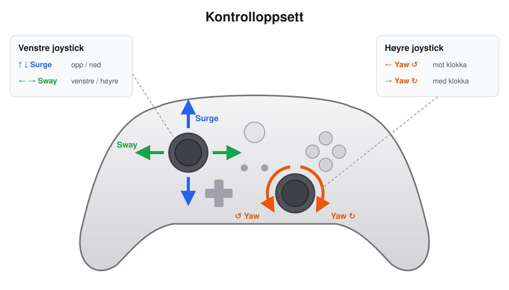

# Thrust Allocation Node

This Node subcribes to `/joy` topic and listens to the axes for xbox360 wired controller. The different axes is configured to map respective output in terms of PWM for the respective thrusters.

Parameters that you are allowed to change in case of new boat:

```python
# Boat parameters PRIMUS
MASS = 35.0
D1X = 0.35
D1Y = 0.1575
D2X = 0.35
D2Y = -0.1575
D3X = 0.25
D3Y = 0.35
DEADZONE = 0.05
```

## How to run

### setup

`terminal:1 and 2`

```bash
source /opt/ros/jazzy/setup.bash
```

whilst in `~/hugr_optimus/optimus_ws`

`terminal:1 and 2`

```bash
source install/setup.bash
```

## Run nodes

`terminal:1`

```bash
ros2 run joy joy_node
```

`terminal:2`

```bash
ros2 run thrust_allocation thrust_allocation
```


